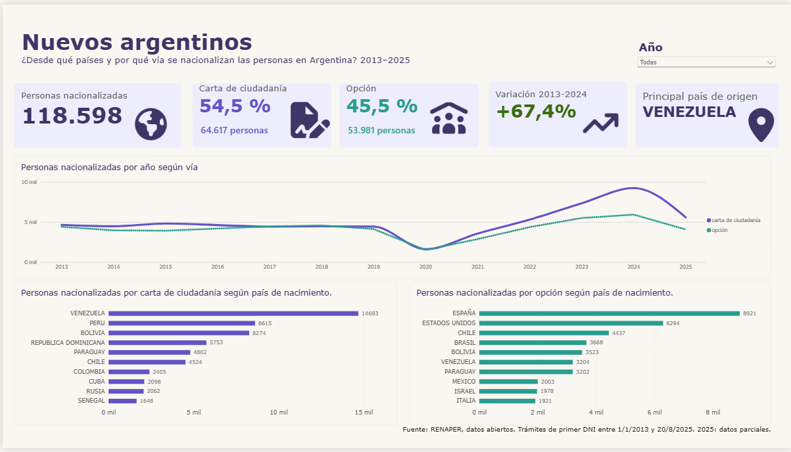
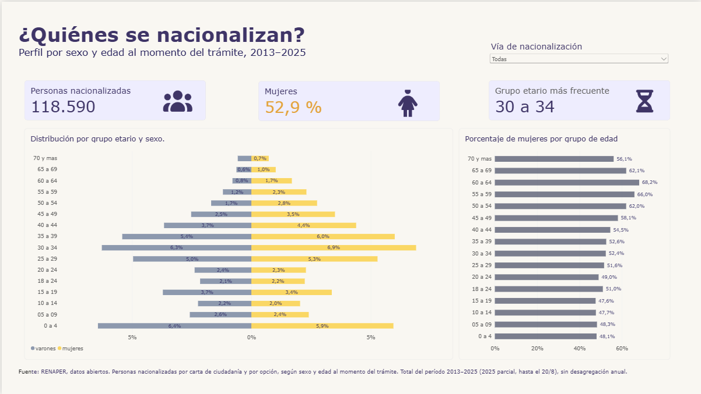



# Nuevos argentinos: un análisis de las nacionalizaciones en Argentina, años 2013–2025

Este segundo trabajo práctico da continuidad al análisis de las nacionalizaciones en Argentina desarrollado en la [primera entrega](https://soyandrea.github.io/visualizacion-info/tp1.html), centrada en la visualización estática de datos. En esta oportunidad, se amplía el análisis mediante la incorporación de información sociodemográfica y el desarrollo de un tablero interactivo en Power BI que permite explorar los resultados desde distintas dimensiones.

## Pregunta de interés

> ¿Cómo evolucionaron las nacionalizaciones en Argentina entre 2013 y 2025 y qué características sociodemográficas presentan las personas nacionalizadas?

El análisis busca identificar los principales países de nacimiento, su evolución durante el período y las diferencias según la vía de acceso a la nacionalidad argentina (carta de ciudadanía u opción). Asimismo, se propone caracterizar a las personas nacionalizadas según sexo y edad al momento del trámite, considerando las particularidades de cada modalidad.

## Fuente de datos

Se utiliza el conjunto de datos *Población nacionalizada en Argentina*, elaborado por la Dirección Nacional de Población a partir de los registros administrativos del RENAPER y publicado en el portal de datos abiertos:

- Dataset: [Población nacionalizada en Argentina](https://datos.gob.ar/dataset/poblacion-nacionalizada-en-argentina)
- Página de referencia: [Estadísticas de población - RENAPER](https://www.argentina.gob.ar/interior/renaper/estadistica-de-poblacion)

Para la elaboración del tablero se utilizaron tres recursos del conjunto de datos:

1.  [**Personas nacionalizadas por tipo de nacionalidad, país de nacimiento y año de trámite (2013–2025)**](https://datos.gob.ar/dataset/poblacion-nacionalizada-en-argentina/resource/33ba92f4-36a2-5e63-8cb1-d0980bf92e3e).
2.  [**Personas nacionalizadas vía carta de ciudadanía por sexo, edad actual y edad al momento del trámite (2013–2025)**](https://datos.gob.ar/dataset/poblacion-nacionalizada-en-argentina/resource/383235e3-c787-596c-a149-e6c0244dd77d).
3.  [**Personas nacionalizadas por opción por sexo, edad actual y edad al momento del trámite (2013–2025)**](https://datos.gob.ar/dataset/poblacion-nacionalizada-en-argentina/resource/e538a17e-cca0-577c-af08-944536281b71).

El primer recurso permite analizar la evolución anual de las nacionalizaciones según país de nacimiento y vía de acceso. Los otros dos incorporan información sociodemográfica por sexo y grupos de edad, diferenciada según la modalidad de nacionalización, aunque sin desagregación anual.

### Unidad de análisis y período

La unidad de análisis corresponde a las personas que obtuvieron la nacionalidad argentina y realizaron el trámite de su primer DNI como argentinas ante el RENAPER, entre el 1 de enero de 2013 y el 20 de agosto de 2025.

En la primera entrega se delimitó el análisis al período 2013–2024, con el propósito de considerar únicamente años completos. Para esta segunda entrega, se amplía el período hasta 2025 debido a la incorporación de las fuentes sociodemográficas, que presentan información acumulada para 2013–2025, sin desagregación anual.

Esta decisión permite trabajar con una cobertura temporal equivalente entre las fuentes, aunque debe considerarse que los registros correspondientes a 2025 son parciales.

## Alcances y limitaciones

- **Cobertura del registro:** Solo se contabilizan personas que tramitaron su primer DNI digital como argentinas. Quedan excluidas quienes tienen documentos confeccionados manualmente (Libreta Cívica, Libreta de Enrolamiento, DNI tapa verde o bordó) y quienes tramitaron el DNI digital fuera del período.

- **Fecha de referencia:** El año corresponde al trámite del primer DNI, no a la fecha de otorgamiento de la nacionalidad, puede existir un desfasaje entre ambos momentos.

- **Información sociodemográfica:** La nueva base permite caracterizar a las personas según sexo y edad al momento del trámite. Al tratarse de información acumulada, no es posible analizar la evolución anual o por país de nacimiento de estas características.

## Preparación y modelado de datos

Los datos se prepararon en Power Query mediante la estandarización de las categorías de nacionalización, la revisión de los tipos de datos y la incorporación de una variable para identificar la vía de acceso. Las dos bases sociodemográficas se anexaron en una única tabla para facilitar la comparación entre carta de ciudadanía y opción.

En Power BI se crearon medidas mediante DAX para calcular los totales de personas, las distribuciones porcentuales, los rankings de países de nacimiento, las variaciones temporales y los indicadores sociodemográficos, como el porcentaje de mujeres y la distribución por grupos de edad. Estas medidas permiten que los resultados se actualicen dinámicamente según los filtros aplicados en el tablero.

## Dashboard interactivo

El tablero fue desarrollado en Power BI y se organiza en dos páginas que permiten explorar distintas dimensiones de las nacionalizaciones en Argentina.

### Página 1. Orígenes y evolución

Esta página recupera las visualizaciones estáticas de la primera entrega e incorpora un segmentador de año que permite actualizar los gráficos según el período seleccionado. Se presentan los principales países de nacimiento por vía de nacionalización, su evolución temporal y un conjunto de indicadores de síntesis que responden dinámicamente a los filtros aplicados.

### Página 2. Perfil sociodemográfico

Esta página amplía el análisis mediante la incorporación de información sociodemográfica. Presenta la distribución por sexo y grupos de edad al momento del trámite del primer DNI argentino, permitiendo comparar los perfiles según la vía de nacionalización. Los resultados corresponden al total de personas nacionalizadas que tramitaron su primer DNI como argentinas durante el período 2013–2025.

::: {.callout-note}
El dashboard interactivo fue desarrollado en Power BI Desktop en un archivo `.pbix`.
:::

